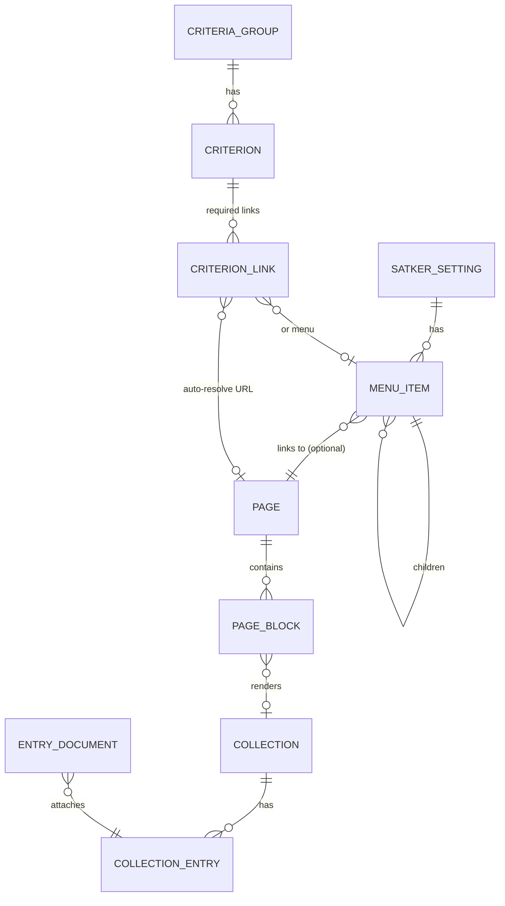

# PRD (Brainstorming): CMS Website Profil Pengadilan Agama ("SatkerCMS")

> Acuan: **SK Dirjen Badilag No. 2722/DJA/SK.TI1/X/2026** (12 Oktober 2026) tentang Petunjuk Teknis Pembaruan, Tata Kelola, dan Evaluasi Website Satker Peradilan Agama. Penilaian dilakukan lewat aplikasi **SINOVA**.
> Status: draf brainstorming. Bagian bertanda ❓ belum diputuskan.

---

## 1. Ringkasan Produk

CMS siap pakai, **satu codebase untuk banyak satker**. Setiap PA/MS cukup memasang, menjalankan setup wizard (nama satker, kode, alamat, logo, domain), dan website langsung punya **seluruh menu wajib SINOVA** dalam kondisi siap diisi. Struktur menu, halaman, dan kriteria penilaian **disimpan di database**, bukan di kode, sehingga perubahan juknis di masa depan cukup ditangani dari CMS.

### Tujuan
1. Nilai maksimal di ketiga aspek SINOVA (Konten 60%, UI/UX 20%, Performa & Keamanan 20%).
2. Nama, identitas, dan konten satker bisa diganti tanpa menyentuh kode (white-label).
3. Menu dan kriteria dinamis: tambah, ubah, atau nonaktifkan dari panel admin.
4. Operator awam bisa mengelola konten. Halaman **"Link Kriteria"** menghasilkan URL yang siap disalin ke SINOVA.

### Di luar cakupan (v1)
- Integrasi tulis ke SIPP/e-Court (hanya tautan/embed baca).
- Multi-tenant dalam satu instalasi (❓ lihat §10).

---

## 2. Tech Stack

| Lapisan | Pilihan | Catatan |
|---|---|---|
| Framework | **Laravel 13.x** (rilis Q1 2026) | Kunci di `"laravel/framework": "^13.0"`, lalu jalankan `composer update` agar dapat patch 13.x terbaru. Versi minor pastinya cek dengan `composer show laravel/framework` saat instalasi. |
| PHP | **8.4** (8.3–8.5 didukung L13) | Wajib non-EOL (juknis Bab II.B.2). Versi PHP termasuk yang dinilai (kriteria 3.a). |
| Reaktif | **Livewire 4.x** | Komponen single-file / class-based, `wire:navigate` untuk SPA-feel di admin. |
| UI Admin | **Flux UI** (gaya shadcn, resmi Livewire) | Komponen Pro (tabel, date picker, editor) berlisensi berbayar. |
| CSS | Tailwind CSS v4 | Token warna: primary `#056e4f`, secondary `#ff9900` (wajib, Bab III.B.1). |
| Frontend publik | Blade + Livewire (hanya di bagian interaktif) + Alpine | Halaman utama dirender server + cache penuh demi target < 5 detik. |
| DB | MySQL 8 / MariaDB 11 / PostgreSQL 16 | User DB khusus, bind 127.0.0.1. |
| Auth | Laravel Fortify | **MFA TOTP wajib** untuk admin, rate limit login, Captcha (Turnstile/hCaptcha atau captcha lokal). |
| RBAC | spatie/laravel-permission | |
| Media | spatie/laravel-medialibrary | Konversi otomatis ke WebP/AVIF, responsive images. |
| Audit | spatie/laravel-activitylog | |
| Backup | spatie/laravel-backup | Mingguan, offsite (S3/Google Drive/NAS). |
| Search | Laravel Scout + driver database (atau Meilisearch opsional) | Kriteria 2.c. |
| Cache | Redis / file + `responsecache` | |
| Queue | database / redis | Untuk pengecekan link, konversi media, screenshot. |

---

## 3. Persona & Peran

| Peran | Hak |
|---|---|
| **Super Admin** (Tim IT) | Setup satker, tema, menu, kriteria, user, keamanan, backup |
| **Admin Konten** | Semua konten + publikasi |
| **Operator Kepaniteraan** | Jadwal sidang, panggilan ghaib, biaya perkara, statistik, prosedur |
| **Operator Kesekretariatan** | SAKIP, keuangan, LHKPN, PBJ, pegawai |
| **Operator PPID/Humas** | Berita, pengumuman, laporan informasi, pengaduan, survei |
| **Penilai internal** (read-only) | Dashboard kepatuhan & Link Kriteria |

---

## 4. Konsep Inti: Menu & Kriteria Dinamis

### 4.1 Menu Builder
- Menu bertingkat (maks. 3 level, sesuai prinsip "hierarkis, tidak membingungkan"), drag & drop.
- Tipe item: **Halaman**, **Koleksi/Modul** (mis. Jadwal Sidang), **URL eksternal** (SIPP, e-Court, SIWAS), **Kategori berita**, **Grup tanpa link**.
- Lokasi menu: header utama, footer, shortcut beranda, sidebar.
- Atribut: ikon, buka di tab baru, visibilitas, urutan, **tag kriteria**.

### 4.2 Page Builder berbasis blok
Halaman disusun dari blok: Rich Text, Tabel, **Daftar Dokumen (per tahun)**, Galeri, Peta (Leaflet/OSM untuk yurisdiksi), Embed (iframe SIPP), Profil Pejabat, Diagram Struktur Organisasi, Statistik, Accordion/FAQ, Kartu Shortcut, Form.

### 4.3 Collections (tipe konten terstruktur)
Konten berulang yang dinilai SINOVA tidak disimpan sebagai teks bebas. Bentuknya **koleksi dengan field tetap** agar kelengkapan bisa dicek otomatis:

| Koleksi | Field kunci |
|---|---|
| Dokumen Kinerja (Renstra, RKT, PK, IKU, LKjIP, Renaksi, Lap. Tahunan) | jenis, tahun, judul, file PDF, status (rancangan/final/reviu) |
| Dokumen Keuangan (DIPA, RPD, Realisasi, LRA, CALK, RUP PBJ) | jenis, tahun, periode/bulan, file |
| LHKPN | pejabat, jabatan, tahun lapor, file ikhtisar |
| Jadwal Sidang | tanggal, no. perkara, para pihak (disamarkan), ruang, agenda (atau embed SIPP) |
| Panggilan Ghaib | nama pihak, no. perkara, tgl sidang, file relaas |
| Laporan Biaya Perkara / Sisa Panjar | bulan, tahun, file/tabel |
| Statistik Perkara | bulan, sisa lalu, masuk, putus, sisa kini (otomatis hitung) |
| Laporan Akses Informasi | periode, jml permohonan, waktu, dikabulkan, ditolak, alasan |
| Rekap Pengaduan / Hukuman Disiplin | inisial, jenis, deskripsi, tindak lanjut, hukuman |
| Survei (SKM/SPAK/SPKP) | periode, nilai, file laporan |
| Pegawai | foto, nama+gelar, NIP, pangkat/gol, jabatan, TMT, pendidikan, riwayat jabatan, kategori (pejabat/pegawai/honorer) |
| Berita / Pengumuman / Artikel / Inovasi | judul, kategori, gambar, isi, tag |

Super Admin bisa **membuat koleksi baru** dengan field kustom (schema JSON) untuk kriteria baru di masa depan.

### 4.4 Modul Kriteria SINOVA (fitur pembeda)
- Tabel `criteria_groups` → `criteria` → `criterion_links`, **di-seed dari juknis 2026**, bisa diedit, diberi versi (`juknis_version`), dan diimpor/ekspor JSON. Saat juknis berganti, cukup impor file kriteria baru.
- Setiap link kriteria bisa:
  - **auto-resolve** ke halaman/menu yang di-tag, atau
  - diisi URL manual (link berlaku sampai diubah, sesuai UI yang Anda contohkan).
- Halaman admin **"🔗 Link Kriteria"**: counter terisi/kosong, Buka/Tutup Semua, tombol salin, ekspor CSV.
- **Health check per link** (job terjadwal): HTTP 200, bukan 404, konten tidak kosong, dokumen tahun berjalan tersedia, statistik bulan terakhir tersedia. Hasilnya badge 🟢 / 🟡 (perkiraan nilai 5) / 🔴 (perkiraan nilai 0).
- **Dashboard Skor Simulasi**: estimasi skor per aspek memakai bobot juknis.
- Pengingat (email/WA ❓) saat data bulanan/tahunan belum diunggah.

---

## 5. Peta Menu Website Publik (default seed)

Mengikuti konsolidasi 6 menu utama (Bab III.F). Kode di kolom kanan = kode di halaman Link Kriteria.

### 5.1 Beranda
Slider 3–5 slide (gambar dikompres), shortcut **SIPP, e-Court, Direktori Putusan, Jadwal Sidang, Survei, Pengaduan** (≤ 2 klik), berita terbaru, pengumuman, banner **Informasi Serta Merta** (downtime/darurat), statistik singkat. **Tanpa** live streaming/animasi berat di beranda.

### 5.2 Profil Pengadilan → `1.b.p` (4 link) + `1.b` alamat
| Halaman | Kriteria |
|---|---|
| Visi & Misi | 1.b.p #1 |
| Tugas Pokok & Fungsi | 1.b.p #2 |
| Wilayah Yurisdiksi (daftar kecamatan + peta) | 1.b.p #3 |
| Struktur Organisasi (diagram + nama pejabat + jabatan, tanpa staf/honorer) | 1.b.p #4 |
| Profil Pimpinan | pendukung |
| Alamat & Kontak (jalan, desa/kel, kec, prov, kode pos, telp, email, URL, foto gedung) | 1.b (1 item) |
| Profil Pejabat & Pegawai | 1.b.3 |

### 5.3 Layanan Hukum (Kepaniteraan)
| Halaman | Kriteria |
|---|---|
| SIPP (tautan SIPP satker) | 1.a.2 #1 |
| Jadwal Sidang (per hari) | 1.a.2 #2 |
| Statistik Perkara (bulanan, 4 komponen) | 1.a.2 #3 |
| Panggilan Ghaib (+ relaas) | 1.a.2 #4 |
| Laporan Penggunaan Biaya Perkara (bulanan) | 1.a.2 #5 |
| Laporan Pengembalian Sisa Panjar (bulanan) | 1.a.2 #6 |
| e-Court (landing page penjelasan + tautan) | 1.b.2 #1 |
| Direktori Putusan (deep-link khusus satker) | 1.b.2 #2 |
| Prosedur Berperkara (Tk. I, Banding, Kasasi, PK, Ambil Produk, Gugatan Sederhana) | 1.b.2 #3 |
| Biaya Proses Berperkara / Panjar & Radius | 1.b.2 #4 |
| Hak Pencari Keadilan (Prodeo/Posbakum), Mediasi | pendukung |

### 5.4 Transparansi (Kesekretariatan) → `1.a.1` (2) + `1.a.3` (11)
| Halaman | Kriteria |
|---|---|
| Rencana Aksi Kinerja (5 thn) | 1.a.1 #1 |
| Laporan Tahunan / Pelaksanaan Kegiatan (5 thn) | 1.a.1 #2 |
| LHKPN (daftar pejabat + ikhtisar, ≥ 2 thn) | 1.a.3 #1 |
| DIPA (DIPA, RPD, Realisasi) | 1.a.3 #2 |
| LRA | 1.a.3 #3 |
| CALK | 1.a.3 #4 |
| Pengadaan Barang & Jasa (RUP) | 1.a.3 #5 |
| Renstra (rancangan/renstra/reviu, 5 thn) | 1.a.3 #6 |
| RKT (5 thn) | 1.a.3 #7 |
| Rencana Aksi Kinerja (tahun berjalan) | 1.a.3 #8 |
| Perjanjian Kinerja (5 thn) | 1.a.3 #9 |
| IKU & Reviu IKU (5 thn) | 1.a.3 #10 |
| LKjIP (5 thn) | 1.a.3 #11 |

Semua halaman dokumen memakai blok **Daftar Dokumen per Tahun**. Untuk satker baru (< 5 tahun), aturan minimal tahun mengikuti setting "Tahun berdiri satker".

### 5.5 Layanan Publik & Pengaduan
| Halaman | Kriteria |
|---|---|
| Laporan Akses Informasi (PPID) | 1.a.4.1 |
| Laporan Rekapitulasi Pengaduan (SIWAS) | 1.a.4.2 |
| Hukuman Disiplin Hasil Pengawasan | 1.a.4.3 |
| Survei Pelayanan (SKM, SPAK, SPKP) | 1.a.4.4 |
| Standar & Maklumat Pelayanan | 1.b.4 |
| Formulir Permohonan Informasi (PPID), Prosedur Pengaduan, Layanan Disabilitas/Kelompok Rentan | pendukung |

### 5.6 Berita & Publikasi
Berita (berorientasi layanan/inovasi), Pengumuman, Artikel/Opini Aparatur, **Inovasi Layanan**, Galeri Infografis.

### 5.7 Lainnya
Statistik Kunjungan Website (analytics bawaan, privacy-friendly, tanpa cookie) → **1.a.4.4 Informasi Lainnya / 5.1**. ❓ Kode di daftar Anda tampaknya menaruh "Informasi Lainnya" di 1.a.4.4; perlu dicocokkan dengan form SINOVA, apakah Survei & Statistik Kunjungan memakai kode yang sama atau berbeda.

### 5.8 Kriteria non-konten (1 item, berupa URL/bukti)
| Kode | Bukti dari CMS |
|---|---|
| 2.a Mobile | URL beranda (layout mobile-first) |
| 2.b WCAG | URL halaman Aksesibilitas + widget (screen reader TTS, kontras tinggi, perbesar teks) |
| 2.c Navigasi & Pencarian | URL `/cari?q=` + sitemap HTML |
| 3.a Keamanan | URL `/admin/login` (menunjukkan MFA) + halaman info versi (❓ hati-hati: membuka versi PHP/CMS bertentangan dengan hardening "sembunyikan versi". Usul: tampilkan di halaman status khusus) |
| 3.b Page Speed | URL beranda (target LCP < 2,5 dtk, muat < 5 dtk) |
| 3.c Validitas Tautan | URL sitemap + laporan internal broken-link = 0 |

---

## 6. Kebutuhan Non-Fungsional (dipetakan ke juknis)

### 6.1 UI/UX & Aksesibilitas (20%)
- Mobile-first, breakpoint 360/768/1280, tap target ≥ 44px.
- Widget aksesibilitas: **baca layar (Web Speech API)**, **kontras tinggi**, **perbesar teks 100–200%** tanpa merusak layout, skip-link, fokus terlihat, alt text **wajib** saat upload gambar (validasi).
- Target WCAG 2.2 AA; uji axe-core di CI.
- Pencarian internal lintas halaman, berita, dokumen (judul + metadata PDF).
- Breadcrumb di semua halaman, sitemap.xml dan sitemap HTML.

### 6.2 Performa (target nilai 10: < 5 detik)
- Full-page cache untuk publik, invalidasi saat konten diubah.
- Gambar WebP/AVIF + `srcset` + lazy-load, font self-hosted subset.
- JS publik minimal (Alpine + Livewire hanya di halaman yang butuh).
- Lighthouse Performance ≥ 90 mobile sebagai acceptance criterion.

### 6.3 Keamanan
- MFA TOTP wajib untuk semua akun admin + recovery codes.
- Rate limit login (5x/menit), Captcha, lockout, notifikasi login baru.
- URL admin bisa dikustom (`/panel-xyz`), opsi IP whitelist.
- Validasi & sanitasi input (Form Request, HTML Purifier untuk rich text), CSRF, CSP header, HSTS, X-Frame-Options, Referrer-Policy.
- Upload: whitelist MIME (PDF, gambar), scan ukuran, nama file di-hash, disimpan di luar webroot dan disajikan lewat controller.
- Tanpa `X-Powered-By`; dokumentasi hardening Nginx/Apache (disable directory listing, server_tokens off, TLS 1.2+, redirect 80→443).
- Activity log semua perubahan konten.
- Backup otomatis mingguan offsite + tombol backup manual.
- Composer audit & Dependabot. Hanya paket resmi, tanpa paket nulled.

### 6.4 Validitas Tautan
- Job harian crawl internal: daftar 404/5xx, link eksternal mati, dokumen hilang.
- Saat slug berubah, **redirect 301 otomatis** dibuat.
- Halaman 404 kustom berisi pencarian dan peta situs.

---

## 7. Fitur Admin (Panel shadcn-style)

1. **Dashboard**: skor simulasi SINOVA, link merah/kuning, data yang belum diunggah bulan ini, statistik pengunjung.
2. **Setup Wizard Satker**: nama ("Pengadilan Agama ___" / "Mahkamah Syar'iyah ___"), kode satker, tingkat (Pertama/Banding, karena beberapa kriteria berbeda), tahun berdiri, alamat lengkap, kontak, logo, favicon, domain, URL SIPP / e-Court / Direktori Putusan / SIWAS / survei.
3. **Pengaturan Tema**: warna terkunci ke standar Badilag (bisa dioverride ❓), logo, font, slider.
4. Menu Builder, Page Builder, Collections, Media Library.
5. **Link Kriteria** (§4.4).
6. **Manajemen Kriteria**: CRUD grup/kriteria/link, bobot, versi juknis, impor/ekspor.
7. User & Role, Keamanan (MFA, sesi aktif), Log Aktivitas, Backup, Broken Link Report, Redirect Manager.
8. Global search (⌘K) gaya shadcn command palette.

---

## 8. Template Variabel Satker
Konten seed memakai placeholder `{{satker.nama}}`, `{{satker.kota}}`, `{{satker.ketua}}`, dll. Ganti nama satker di Setup, maka seluruh teks default, meta SEO, footer, dan judul ikut berubah.

---

## 9. Roadmap Usulan

| Fase | Isi | Output |
|---|---|---|
| 0 | Instal L13 + Livewire 4 + UI kit, auth MFA, RBAC, setup wizard | Fondasi |
| 1 | Menu builder, page builder, media, collections inti | CMS dasar |
| 2 | Seed seluruh menu & koleksi wajib juknis 2026, tema publik | Website siap isi |
| 3 | Modul Kriteria + Link Kriteria + health check + dashboard skor | Siap SINOVA |
| 4 | Aksesibilitas, search, cache, broken-link crawler, hardening | Nilai aspek 2 & 3 |
| 5 | Installer/updater, dokumentasi operator, paket rilis | Siap dibagikan ke satker lain |

---

## 10. Keputusan (18 Nov 2026)
| # | Topik | Keputusan |
|---|---|---|
| 1 | UI kit admin | **Flux UI** (Livewire resmi) |
| 2 | Distribusi | **Satu instalasi per satker** |
| 3 | Jadwal sidang & statistik | **Embed / tautan dari SIPP satker** (URL diatur di Setup) |
| 4 | Tingkat peradilan | **Mendukung PA/MS (Tk. Pertama) dan PTA/MS Aceh (Banding)**. Setting `tingkat` di Setup Wizard menentukan set kriteria, menu seed, dan konten default (mis. SIPP Banding → banding.mahkamahagung.go.id, yurisdiksi = kab/kota, panggilan ghaib = halaman penjelasan, sisa panjar hanya Tk. I) |
| 5 | Versi PHP/CMS di publik | Header `Server`/`X-Powered-By` **disembunyikan**. Bukti 3.a lewat halaman publik **`/status-sistem`** (versi CMS, Laravel, cabang PHP + status dukungan, SSL, MFA aktif); URL-nya otomatis jadi link 3.a |
| 6 | Copas URL ke SINOVA | Menu admin khusus **"🔗 Link SINOVA"**: urutan & kode identik dengan SINOVA (accordion, Buka/Tutup Semua, counter terisi/kosong); per baris: nama sub-kriteria, URL absolut, 📋 Salin, ↗ Buka, badge 🟢/🟡/🔴; URL auto dari halaman ber-tag, bisa override manual (persisten); "Salin semua" per grup; ekspor CSV/PDF; peringatan saat menyalin link 🔴. Tanpa fitur penanda "sudah diinput" |
| 7 | Ganti tingkat setelah setup | `tingkat` **terkunci** setelah wizard; hanya Super Admin via konfirmasi ganda. Saat diganti: menu/kriteria tingkat baru **ditambahkan**, konten lama **dinonaktifkan, tidak dihapus** |
| 8 | Update kriteria saat juknis berubah | File **JSON berversi** (`juknis-2026.json`) dirilis bersama update CMS; Super Admin klik Impor → **preview diff** (baru/berubah/dihapus) → terapkan; link terisi dipertahankan bila kode sama. Edit manual tetap tersedia |
| 9 | Mekanisme update CMS | Repo Git + tag rilis; `php artisan cms:update` (backup → pull tag → migrate → clear cache → health check); banner di dashboard untuk versi baru / PHP mendekati EOL; **tidak ada auto-update** dan tidak ada tombol update via web |
| 10 | Guardrail beranda | Slider **dipaksa 3–5 slide**; gambar auto-resize + WebP; **alt text wajib**; blok video/live streaming **diblokir** di beranda; peringatan bobot halaman di dashboard |
| 11 | Warna & tema | Primary `#056e4f` & secondary `#ff9900` **dikunci**; satker bebas logo, foto, slider, font (dari daftar terkurasi); `#ff9900` hanya aksen dengan teks gelap (bukan latar teks putih) demi WCAG AA; mode kontras tinggi di widget aksesibilitas |
| 12 | Widget aksesibilitas (2.b) | **Custom, tanpa pihak ketiga**: TTS via Web Speech API (id-ID), kontras tinggi, perbesar teks s.d. 200%, font disleksia, sorot link, stop animasi; preferensi di localStorage; HTML semantik + ARIA; halaman **Pernyataan Aksesibilitas** = link 2.b |
| 13 | Pegawai & Struktur Organisasi (SIMTEPA) | Mode sumber per halaman: **Embed SIMTEPA** (utama) / **Manual** (cadangan) / **Otomatis** (hanya jika Embed dan cadangan manual sama-sama diisi). Profil Pegawai: embed SIMTEPA, cadangan data pegawai manual (+ impor Excel). Struktur Organisasi: embed SIMTEPA, cadangan **upload gambar** atau diagram otomatis dari data pejabat. Health check memantau link SIMTEPA; bila mati, halaman **otomatis beralih ke manual** dan admin diberi notifikasi. Data pejabat lokal tetap dipakai untuk Profil Pimpinan & LHKPN. NIP/tgl lahir/kontak pribadi tidak ditampilkan |
| 14 | Blok "Embed + Cadangan" (generik) | Blok Page Builder umum untuk semua sumber eksternal (SIPP, SIMTEPA, SIWAS, survei, dll.): URL embed + tautan "Buka di sumber" + konten cadangan (tabel/form/PDF/gambar). Auto-switch ke cadangan bila health check gagal. **Jadwal Sidang**: cadangan tabel manual / PDF harian. **Statistik Perkara**: cadangan form bulanan 4 angka (sisa kini dihitung otomatis) |
| 15 | Statistik kunjungan (5.1) | Analytics bawaan tanpa cookie, halaman publik `/statistik-pengunjung` |
| 16 | Pencarian (2.c) | Laravel Scout driver database (halaman, berita, judul dokumen) |
| 17 | Captcha login | Captcha lokal (gambar), tanpa layanan eksternal |
| 18 | Backup offsite | Mingguan, tujuan Google Drive / S3 diatur di admin |
| 19 | Bahasa | Indonesia saja (v1) |
| 20 | Tooling AI agent | **Laravel Boost** (`laravel/boost --dev`, `boost:install`): MCP server, guideline & skill sesuai versi (Laravel 13, Livewire 4, Flux, Pest, Tailwind), dokumentasi resmi; `boost:update` dijalankan setiap upgrade paket. Aturan proyek di `.ai/` |
| 21 | Testing | Pest 4 + browser test untuk alur kritis |

> **Status PRD: FINAL v1.0 (18 Nov 2026).** Bagian §11 di bawah disimpan sebagai riwayat; semuanya sudah terjawab di tabel ini.

## 11. Pertanyaan Terbuka ❓ (lama)
1. **UI kit admin**: Flux UI (berbayar untuk komponen Pro), Mary UI, atau port shadcn ke Blade sendiri?
2. **Distribusi**: satu instalasi per satker (lebih aman, sesuai juknis server terpisah) atau multi-tenant satu server?
3. **Jadwal sidang & statistik**: input manual, embed SIPP, atau tarik otomatis dari SIPP publik (scraping, rawan rusak)?
4. Apakah CMS juga dipakai **PTA (tingkat banding)**? Jika ya, kriteria per tingkat perlu dicabangkan.
5. Format "1 item" pada 1.b, 2.b, 2.c, 3.a–3.c: apakah di SINOVA berupa satu URL atau Ya/Tidak?
6. Tampilkan versi PHP/CMS di publik atau tidak (konflik antara kriteria 3.a dan hardening)?
7. Integrasi notifikasi (email/WhatsApp) untuk pengingat unggah?
8. Lisensi & cara update antar satker (Git tag + `php artisan cms:update`?).

